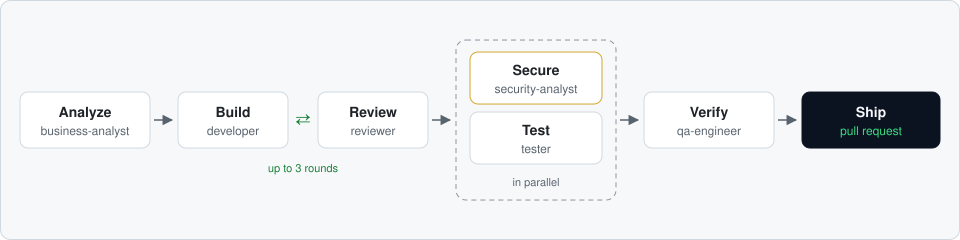

<p align="center">
  
</p>

<p>
  <a href="https://github.com/Nuclominus/agentic-sdlc-pluguin/releases/latest"></a>
  <a href="https://github.com/Nuclominus/agentic-sdlc-pluguin/actions/workflows/ci.yml"></a>
  <a href="LICENSE"></a>
  
  
</p>

You describe a feature in plain language; a team of specialist agents takes it through
requirements, implementation, review, security audit and tests, then opens a pull request. One
core drives the pipeline; **Android Foundation** adds the platform knowledge on top.

## How it works

<picture>
  <source media="(prefers-color-scheme: dark)" srcset="docs/assets/pipeline-dark.svg">
  
</picture>

<p align="center"><sub>The default <code>android-feature</code> workflow. Recipes can add phases, parallel groups and review loops.</sub></p>

### Three layers, wired automatically

| Layer | Kind | What it brings |
| ----- | ---- | -------------- |
| **Embedded frameworks** | `framework` | Retrofit · Ktor · Room · Proto DataStore · Dagger/Hilt · Koin · WorkManager — each turns on only when your Gradle build uses it |
| **`android-foundation`** | `foundation` | Android expertise for 11 roles: conventions, review and test playbooks, MASVS audit, house rules, 21 skills |
| **`sdlc`** | core | The pipeline orchestrator and all 13 agents. Knows the process, nothing about any platform |

Everything is discovered by glob — manifests, workflows, dependencies. Full contract →
[`docs/WORKFLOW.md`](docs/WORKFLOW.md)

## Quickstart

```bash
# Add the marketplace — pinned to the stable release channel
/plugin marketplace add Nuclominus/Agentic-SDLC-Pluguin@release

# Install Android Foundation (the sdlc core installs as a dependency)
/plugin install android-foundation@agentic-sdlc

# Verify
/sdlc:doctor
/sdlc:list-stacks

# Run
/sdlc:start "Add a settings screen with a dark-mode toggle"
```

`@release` pins installs and updates to the stable `release` branch; omit it to track `develop`.
Step-by-step guide, optional dependencies and upgrading an existing install →
[`docs/INSTALLATION.md`](docs/INSTALLATION.md)

## Commands

| Command | Purpose |
| ------- | ------- |
| `/sdlc:start "feature"` | Run the pipeline; `--brief=docs/briefs/<slug>.md` starts from a written brief |
| `/sdlc:brief ["idea"]` | Interview you and write a task brief |
| `/sdlc:ask-me "question"` | Sourced answers about the project, read-only |
| `/sdlc:batch "t1" "t2"` | Parallel pipelines in isolated worktrees |
| `/sdlc:init` | Detect the stack, scaffold `.sdlc/sdlc.local.yaml` |
| `/sdlc:extension [--list]` | Author the Project Extension Manifest |
| `/sdlc:report` | Cost rollup across all runs (deterministic, no LLM) |
| `/sdlc:aar` | After Action Review of the last run |
| `/sdlc:doctor` | Preflight: dependencies, skills, detection, config migration |
| `/sdlc:list-stacks` | Detected stack profiles and priorities |
| `/sdlc:security-init` | Materialize security patterns |

## Plugins

| Plugin | Type | What it brings |
| ------ | ---- | -------------- |
| `sdlc` | Core | Orchestrator + the 13-agent roster |
| `android-foundation` | Stack provider | Android expertise, MASVS / MASTG audit, Obsidian vault support, 7 embedded frameworks |

**Optional:** `superpowers` and `security-guidance` from `claude-plugins-official`, and Google's
Android CLI skills. Everything degrades gracefully without them →
[`docs/INSTALLATION.md`](docs/INSTALLATION.md#3-optional-dependencies)

Security and the optional project vault are covered in
[`plugins/android-foundation/README.md`](plugins/android-foundation/README.md).

## Documentation

[Walkthrough](docs/WALKTHROUGH.md) · [Workflow recipes](docs/RECIPES.md) ·
[Cost & models](docs/COST-AND-MODELS.md) · [Configuration](docs/CONFIGURATION.md) ·
[Installation & upgrading](docs/INSTALLATION.md) · [Changelog](CHANGELOG.md)

This repo's own architecture, decisions and per-PR history live in the [`.brain/`](.brain/README.md)
Obsidian vault.

## Contributing

Add a foundation or framework plugin with [`CONTRIBUTING.md`](CONTRIBUTING.md) or the
`sdlc:create-pluguin` wizard. Requires Claude Code (latest), API Tier 2+ or Claude Max, a Git
repo, and a JDK + Gradle wrapper for Android projects. MIT licensed — see [`LICENSE`](LICENSE).
